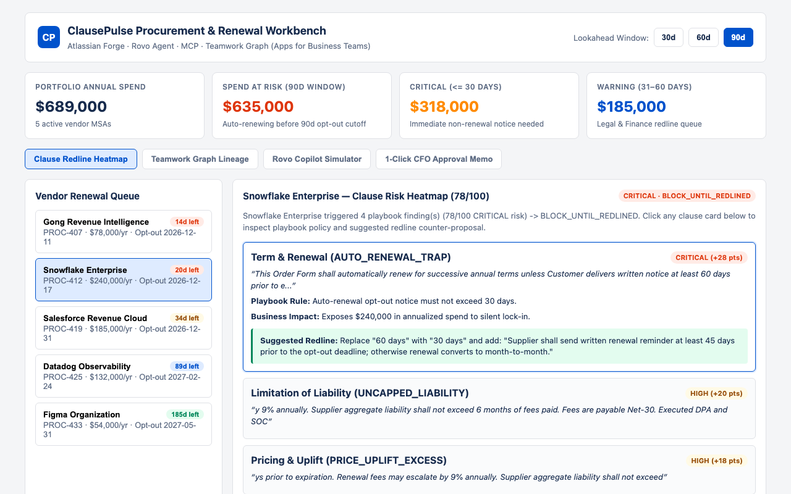

# ClausePulse

**Contract Renewal, Clause Risk & Vendor Procurement Approval Copilot for Atlassian Jira Service Management & Confluence**

ClausePulse is an Atlassian Forge app built for Legal, Finance, Procurement, and RevOps teams. It combines a deterministic commercial-clause policy engine, a Rovo Agent (`ClausePulse Procurement & Legal Copilot`), an Atlassian MCP server (`rovo:mcp`), and a Teamwork Graph connector to eliminate surprise SaaS auto-renewals and speed up CFO/Legal signoff.

## Why ClausePulse?

Most procurement bottlenecks happen in the gap between Jira Service Management approval tickets, Confluence MSA/DPA pages, and Finance renewal calendars:
- A 60-day or 90-day auto-renewal notice window slips past while Legal reviews an uncapped liability clause.
- Price-uplift clauses (`7%–12%` annual escalators) get signed without Finance visibility.
- Missing DPA / GDPR / SOC2 Type II language stalls security signoff late in the quarter.

ClausePulse runs **100% deterministically inside Atlassian Forge (`nodejs24.x`)** with **zero paid external LLM API keys**: Rovo handles natural-language orchestration while ClausePulse's TypeScript engine scores clauses against your company playbook, computes exact opt-out deadlines and annualized dollars at risk, and generates ready-to-post CFO & Legal approval memos in ADF and Markdown.

## Architecture

- **`manifest.yml`**: Atlassian Forge `nodejs24.x` manifest declaring `jira:issuePanel`, `rovo:agent`, 8 `action` modules (4 Rovo agent actions + 4 MCP tool actions), `rovo:mcp`, and scoped permissions, validated against Atlassian's official `@forge/manifest` schema validator.
- **`src/contracts/clauseAnalyzer.ts`**: Deterministic commercial contract risk engine scoring auto-renewal traps, uncapped liability, unilateral price-uplift caps, DPA/GDPR/SOC2 compliance gaps, and net-payment term deviations against configurable playbook rules, complete with redline counter-proposals.
- **`src/contracts/renewalScheduler.ts`**: Exact opt-out notice window and annualized spend exposure calculator (30/60/90-day lock-in buckets and dollars at risk).
- **`src/graph/vendorGraph.ts`**: Teamwork Graph connector linking `VendorEntity` <-> `ConfluenceContractPage` <-> `JiraApprovalTicket` <-> `RenewalDeadlineNode`, plus a realistic SaaS procurement portfolio fallback.
- **`src/rovo/businessActions.ts`**: Typed Rovo action handlers (`scoreClauseRisk`, `calculateRenewalDeadlines`, `generateApprovalBrief`, `compareVendorTerms`) producing Atlassian Document Format (ADF) and Markdown executive briefs.
- **`src/mcp/procurementTools.ts`**: 4 strictly typed MCP tools (`audit_contract_clauses`, `forecast_renewal_exposure`, `build_cfo_approval_memo`, `query_vendor_graph`) with JSON Schema validation.
- **`src/resolvers/index.ts`**: Forge Resolver with `@forge/api` live adapter and deterministic standalone demo portfolio fallback.
- **`static/panel/`**: Vite + React + TypeScript Atlassian-styled Custom UI workbench (`--base=./`) featuring an Annualized Auto-Renewal Spend-at-Risk Countdown Strip, Interactive Clause Redline Heatmap, Teamwork Graph view, Rovo Copilot Simulator, and 1-Click CFO Approval Memo Preview.

## Live Demo & Architecture Deck

- **Interactive Workbench (GitHub Pages)**: [https://alphonshhhomenicmtu.github.io/clausepulse-codegeist/](https://alphonshhhomenicmtu.github.io/clausepulse-codegeist/)
- **8-Slide Judge Architecture Deck (PDF)**: [https://alphonshhhomenicmtu.github.io/clausepulse-codegeist/clausepulse-deck.pdf](https://alphonshhhomenicmtu.github.io/clausepulse-codegeist/clausepulse-deck.pdf) · [`docs/clausepulse-deck.pdf`](./docs/clausepulse-deck.pdf)
- **Repository**: [https://github.com/alphonshhhomenicmtu/clausepulse-codegeist](https://github.com/alphonshhhomenicmtu/clausepulse-codegeist)



## Quick Verification

```bash
npm install
npm run typecheck
npm test
npm run build
```

## Documentation

- [`skill.md`](./skill.md) — Companion MCP & Rovo agent skill specification.
- [`DEPLOY_CHECKLIST.md`](./DEPLOY_CHECKLIST.md) — Step-by-step Atlassian Forge CLI registration, deployment, and Codegeist verification checklist.
- [`LICENSE`](./LICENSE) — MIT License.
